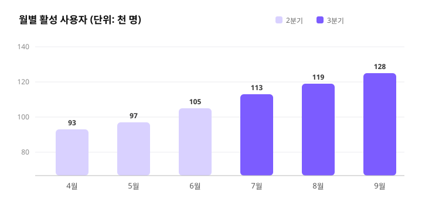

# 2026년 3분기 서비스 운영 보고서

> **작성자** 운영팀 · **작성일** 2026년 10월 1일 · **대상** 경영진 및 팀 리더

---

## 1. 요약

3분기에는 **월간 활성 사용자(MAU)가 전 분기 대비 18% 증가**했고, 유료 전환율은 4.2%에서 5.1%로 개선되었습니다. 신규 온보딩 흐름과 추천 기능 개편이 성장을 이끌었으며, 고객 문의 응답 시간은 평균 3.1시간에서 1.4시간으로 줄었습니다.

- 월간 활성 사용자: **128,400명** (+18%)
- 유료 전환율: **5.1%** (+0.9%p)
- 고객 만족도(CSAT): **4.6 / 5.0**

## 2. 주요 지표

| 지표 | 2분기 | 3분기 | 증감 |
| --- | ---: | ---: | ---: |
| 월간 활성 사용자 | 108,800 | 128,400 | +18.0% |
| 신규 가입자 | 21,300 | 26,900 | +26.3% |
| 유료 전환율 | 4.2% | 5.1% | +0.9%p |
| 평균 응답 시간 | 3.1시간 | 1.4시간 | −54.8% |

## 3. 성과 분석

### 3.1 온보딩 개편

가입 직후 3단계 안내를 도입한 결과, 가입 후 7일 내 핵심 기능 사용률이 **37% → 52%**로 상승했습니다.

### 3.2 추천 기능

사용 기록 기반 추천을 적용한 뒤 세션당 체류 시간이 평균 2분 늘었습니다. 다만 신규 사용자에게는 추천 정확도가 낮아 개선이 필요합니다.

## 4. 이슈 및 리스크

1. **결제 오류**: 8월 중 특정 카드사 결제 실패율이 일시적으로 3%까지 상승 — 원인 해결 완료
2. **서버 비용**: 트래픽 증가로 인프라 비용이 22% 늘어 최적화 필요
3. **인력**: 고객지원 인력 충원이 지연되어 4분기 채용 우선 진행

## 5. 4분기 계획

- [ ] 신규 사용자용 추천 모델 개선
- [ ] 인프라 비용 15% 절감 (캐시 정책 · 예약 인스턴스)
- [ ] 고객지원 인력 2명 충원
- [ ] 연간 요금제 출시

## 6. 결론

3분기는 성장과 효율 개선을 동시에 달성한 분기였습니다. 4분기에는 **비용 최적화**와 **신규 사용자 경험 개선**에 집중해 연간 목표인 MAU 15만 명을 달성하겠습니다.

---

*부록: 상세 데이터는 운영팀 공유 드라이브의 `2026-Q3` 폴더를 참고하세요.*
